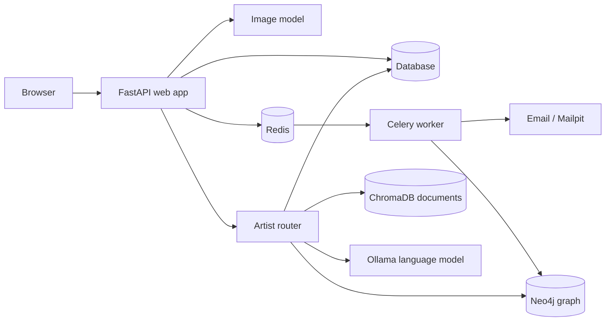
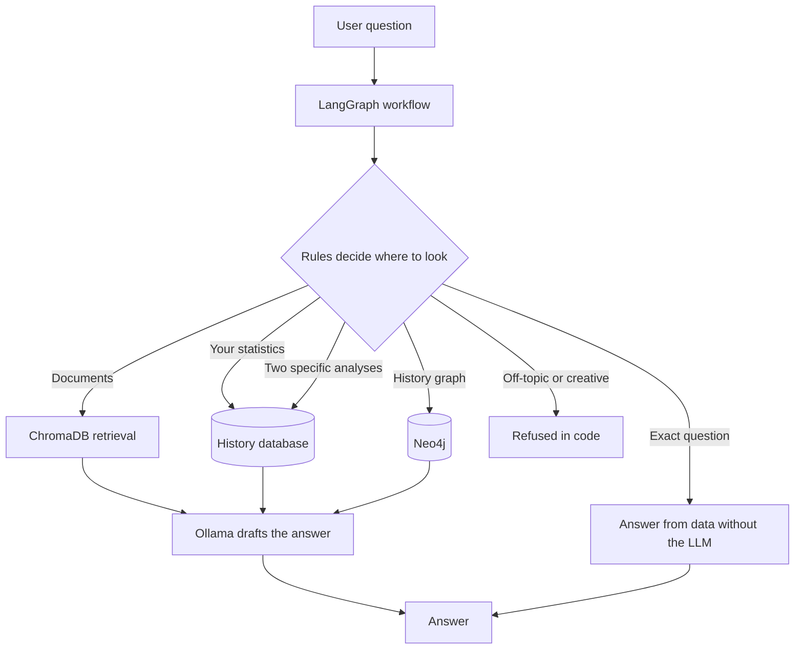

# VisionGuard Platform (23L-0787_A2_Ops)

[](https://github.com/Abdul-Rehman-0787/23L-0787_A2_Ops/actions/workflows/ci.yml)

VisionGuard estimates whether an uploaded image is **AI-generated or real**, keeps a **private history for each user**, and includes **Artist**, an assistant that explains results using the project documents, your own history and a history graph. It is an end-to-end MLOps project: data versioning (DVC), model training (TensorFlow/Keras), experiment tracking and a model registry (MLflow on DagsHub), a TFLite model API, a FastAPI web app, Redis/Celery background work, Neo4j graph storage, ChromaDB document search and a local Ollama language model. Everything runs on one laptop with free tools.

> A verdict is a model estimate, not proof. The model was trained on about 1,000 images and reaches about **79% accuracy** on 147 held-out test images (**ROC-AUC about 0.87**). It reacts to style more than to real signs of AI generation. See `docs/MODEL_CARD.md`.

**Author:** Abdul-Rehman, roll number 23L-0787, BSCS, FAST NUCES Lahore

> **Branch note:** `main` holds the frozen assignment version (tag `assignment-final`). This `platform` branch is the active project. The live links below serve the assignment deployment; the platform runs locally because free hosting tiers cannot run the language model.

## Live links

| What | Link |
|---|---|
| Web app (assignment version, `main`) | https://two3l-0787-a2-ops.onrender.com/ |
| Model API (health check, assignment version) | https://visionguard-vkzn.onrender.com/health |
| Source code | https://github.com/Abdul-Rehman-0787/23L-0787_A2_Ops |
| Experiments, data and model registry | https://dagshub.com/Abdul-Rehman-0787/23L-0787_A2_Ops |

The assignment services run on Render's free tier and **sleep after about 15 minutes without traffic**. The first request after a pause can take around a minute. Open the API `/health` page and the web app a minute before a demo.

`POST /predict` on the assignment API needs an `X-API-Key` header. The key is stored only in Render's environment settings and in a git-ignored `.env`, never in the repository.

## How it fits together



- **Login:** email and password, then a 6-digit emailed code (stored hashed in Redis for 5 minutes). Sessions are signed cookies that can be revoked. Five wrong passwords or codes lock the account for 15 minutes.
- **Analysis:** images are analysed in memory and never stored. Only the file fingerprint (SHA-256), size, verdict, probability, threshold and model version are saved.
- **Artist:** a LangGraph workflow. Plain rules choose where to look (documents, your statistics, the history graph, or two specific analyses). Exact questions are answered from the data without the language model. Off-topic and creative requests are refused in code.

### Artist workflow



## Continuous integration and tests

Every push and pull request runs `.github/workflows/ci.yml`:

| Job | What it does |
|---|---|
| `test` | Installs `requirements.txt`, lints with `ruff check app src tests run.py`, runs `pytest -q` |
| `docker` | Runs after `test` passes and builds the Docker image |

External services (Redis, Neo4j, Ollama, email) are replaced by fakes in the tests, so CI needs no model, database or secret. `tests/test_graph_live.py` runs real Cypher and skips itself when Neo4j is not running.

Run the same checks locally before pushing:

```powershell
pytest -q
ruff check app src tests run.py
```

Measurements:

| Command | What it measures |
|---|---|
| `python -m src.rag_check` | Document retrieval quality |
| `python -m src.benchmark_platform` | Speed and memory |

The badge at the top of this file shows the status of the latest run. All runs are listed under the repository's **Actions** tab.

## Dataset

[AI Generated Images vs Real Images](https://www.kaggle.com/datasets/cashbowman/aigenerated-images-vs-real-images) from Kaggle. The label of an image is the folder it sits in (`AiArtData` is class 1, `RealArt` is class 0).

| | Count |
|---|---|
| Images audited | 975 (539 AI, 436 real) |
| Corrupt files | 0 |
| Exact duplicates (SHA-256) | 1, removed before splitting |
| Train / validation / test | 681 / 146 / 147 (stratified, seed 42) |

The raw images are **not in Git**. DVC tracks them (`data/raw.dvc`) and the files live in DagsHub storage. The small split lists in `data/splits/` are committed.

## Models

| Model | Summary |
|---|---|
| Baseline CNN | Three Conv + BatchNorm + ReLU + MaxPool blocks (32, 64, 128 filters), global average pooling, dropout, one sigmoid output |
| Transfer learning | ImageNet-pretrained MobileNetV2 without its classifier. Stage 1 trains only the new head (learning rate 1e-3). Stage 2 unfreezes the last block with a much smaller learning rate (1e-5), keeping BatchNorm frozen |

Common training choices: 224x224 input, augmentation (flip, rotation, zoom, contrast) on the training split only, binary cross-entropy with Adam, fixed seed, early stopping, checkpointing on validation loss and learning-rate reduction.

Selected results (validation loss, lower is better; full metrics are in the DagsHub experiments):

| Run | Best epoch | Validation loss |
|---|---|---|
| Baseline CNN | 29 | 0.5901 |
| MobileNetV2, stage 2 (fine-tuned) | 7 | 0.4778 |
| Best Keras Tuner trial (30 unfrozen layers, dropout 0.2, lr 6.6e-5) | n/a | 0.4250 |

On the 147-image test set the deployed model reaches about **79% accuracy** and **ROC-AUC about 0.87**.

The model registered as **`visionguard`** with the alias **`champion`** is the one deployed. The cloud API reports version 2 with a decision threshold of 0.48, chosen on the validation split. Test-set metrics are reported once, in the project report and `docs/MODEL_CARD.md`.

Two export findings from the platform work:

- A resize difference between training and the cloud API changed **7 of 147** labels. A TensorFlow-exact NumPy resize reduced this to **1 of 147**.
- A quantized model was tested and **not adopted**.

## Experiment tracking

Experiments are logged to MLflow on DagsHub through environment variables (see `.env.example`). Runs record parameters, per-epoch metrics, tags (git commit, DVC data hash, seed), and artifacts (confusion matrix, ROC curve, split lists, package list, model). The experiment `visionguard` holds the comparison runs, each differing from another by one change: learning rate, augmentation, unfrozen layers, image size, backbone, and manual versus autolog logging.

## Repository layout

```
app/              FastAPI web app, login, Artist, graph and background tasks
api/              Model API for cloud deployment (Flask + TFLite, API-key protected)
src/              Data, training, tracking, export, benchmark and demo scripts
knowledge/        Documents that Artist searches
tests/            Automated checks (pytest)
docs/             Decisions and model card
data/             DVC pointer (raw.dvc), audit.csv, splits/
reports/          Figures and small result files
.github/workflows/ci.yml
Dockerfile
docker-compose.yml
requirements.txt
dev.ps1
run.py
```

## Quick start

Everything below is for Windows PowerShell from the project root. You need **Python 3.13**, **Docker Desktop** and [Ollama](https://ollama.com).

### 1. Environment and data

```powershell
python -m venv .venv
.\.venv\Scripts\Activate.ps1
pip install -r requirements.txt
copy .env.example .env          # then fill in the secrets
ollama pull llama3.2:3b
python -m src.download_champion # needs the DagsHub token in .env
python -m src.index_knowledge
```

`.env` is git-ignored. Fill in your own values before running.

### 2. Run the platform

```powershell
.\dev.ps1
```

This starts the Docker services, the Celery worker and the web app. Open http://localhost:5000. Login codes arrive in the fake inbox at http://localhost:8025.

### 3. Run manually (without `dev.ps1`)

In one terminal:

```powershell
docker compose up -d redis mailpit neo4j
celery -A app.tasks:celeryApp worker --pool=solo --loglevel=info
```

In a second terminal:

```powershell
python run.py
```

After editing anything in `knowledge/`, run `python -m src.index_knowledge` and restart the web app.

### 4. Reproduce the training

```powershell
python src\audit.py
python src\make_splits.py
python src\train_mlflow.py --run-name r1_base
python src\compare_runs.py
python src\register_model.py <RUN_ID> champion
```

### 5. Run the tests and measurements

```powershell
pytest -q
ruff check app src tests run.py
python -m src.rag_check
python -m src.benchmark_platform
```

## Configuration

| Variable | Purpose | Default |
|---|---|---|
| `INFERENCE_MODE` | `local` (Keras file) or `remote` (cloud API) | `local` |
| `API_URL`, `API_KEY`, `API_TIMEOUT` | Cloud API address, key and timeout (seconds) | empty, empty, 90 |
| `MODEL_PATH`, `MODEL_NAME`, `MODEL_VERSION`, `THRESHOLD` | Local model file and the values recorded in history | `models/champion.keras`, `visionguard`, `unknown`, `0.5` |
| `DATABASE_URL` | SQLAlchemy URL for the history database | `sqlite:///instance/visionguard.db` |
| `REDIS_URL`, `CELERY_BROKER_URL` | Redis for codes, sessions, limits and the job queue | set in `.env` |
| `JWT_SECRET`, `OTP_SECRET` | Random strings of at least 32 characters | set in `.env` |
| `NEO4J_PASSWORD` | Empty switches the history graph off | empty |
| `OLLAMA_MODEL` | Language model used by Artist | `llama3.2:3b` |
| `RAG_MIN_SIMILARITY` | How close a passage must be to be used | `0.55` |
| `MAX_UPLOAD_MB` | Upload size limit | 5 |
| `POSTGRES_USER`, `POSTGRES_PASSWORD`, `POSTGRES_DB` | Compose database credentials | set in `.env` |
| `MLFLOW_TRACKING_URI`, `MLFLOW_TRACKING_USERNAME`, `MLFLOW_TRACKING_PASSWORD` | DagsHub MLflow access | set in `.env` |

## Platform features

| Area | Description |
|---|---|
| Login | Email and password, then a 6-digit emailed code. Codes are stored hashed in Redis for 5 minutes. Sessions are signed cookies that can be revoked. Five wrong passwords or codes lock the account for 15 minutes. |
| Analysis | Images are analysed in memory and never stored. Only the SHA-256 fingerprint, size, verdict, probability, threshold and model version are saved. |
| History | A private history for each user: what was decided, when, by which model and version, and how confidently. |
| Artist | A LangGraph workflow over project documents (ChromaDB), your statistics, the Neo4j history graph and specific analyses. Exact questions are answered without the LLM. Off-topic and creative requests are refused in code. |
| Health | JSON health check (database and model status). |

Uploads are validated by type, size and by actually decoding the image. File names are sanitized and the image itself is never written to disk. Errors are shown as friendly messages.

## Model API

The `api/` folder contains the small TFLite model API used when `INFERENCE_MODE=remote` and for the assignment's cloud deployment.

`GET /health`

```json
{"model": "visionguard", "status": "ok", "threshold": 0.48, "version": "2"}
```

`POST /predict` with header `X-API-Key: <key>` and multipart form field `file`:

```powershell
curl.exe -H "X-API-Key: $env:API_KEY" -F "file=@photo.jpg" https://visionguard-vkzn.onrender.com/predict
```

```json
{
  "label": "AI-generated",
  "confidence": 0.94,
  "prob_ai": 0.94,
  "threshold": 0.48,
  "model_name": "visionguard",
  "model_version": "2",
  "width": 1024,
  "height": 1024,
  "file_size": 123456,
  "latency_ms": 85.2
}
```

| Status | Meaning |
|---|---|
| 200 | Prediction returned |
| 400 | No file in field `file`, or the file cannot be decoded |
| 401 | Missing or wrong API key |
| 413 | File larger than 5 MB |
| 415 | Unsupported image type (allowed: JPEG, PNG, WEBP) |

The API runs a TFLite copy of the champion with a small runtime, because Render's free tier has 512 MB of RAM. Preprocessing is a bilinear resize to the model's input size; the rescaling layer is inside the model. The difference between this and the TensorFlow resize used in training was measured and is reported in the project report.

## Deployment

| Component | Platform | Notes |
|---|---|---|
| Assignment web app (`main`) | Render web service, free instance | Frozen assignment version, tag `assignment-final` |
| Assignment model API (`main`) | Render web service, free instance | Python runtime, root directory `api`, API key in environment settings |
| Platform branch | Local laptop | FastAPI + Redis + Neo4j + Ollama; free hosting tiers cannot run the language model |
| Data and experiments | DagsHub | DVC storage and MLflow tracking server |

The assignment's required setup is the model API in the cloud and the web app calling it. The platform branch runs locally and in Docker Compose.

## Security and privacy

- Images are never written to disk. Only the fingerprint and the prediction metadata are stored.
- Login codes are hashed in Redis and expire after 5 minutes.
- Sessions are signed cookies and can be revoked.
- Five wrong passwords or codes lock the account for 15 minutes.
- Secrets live in the untracked `.env`, never in the repository.

## Limitations

- The dataset is small (975 images), so scores have wide uncertainty and the model can be wrong on edited images, screenshots or styles it has not seen. Paintings and natural-looking AI portraits are typical mistakes.
- Confidence is a model score, not a guaranteed probability. VisionGuard gives an estimate, not proof of origin.
- Artist runs a small local model on the CPU. Questions about documents take roughly 10 to 30 seconds.
- The platform is local only so far. Free hosting tiers cannot run the language model, so a hosted free model API would be needed for a public demo.
- The assignment services on Render's free tier sleep when idle and have limited CPU.

## Acknowledgements

Dataset by cashbowman on Kaggle. An AI assistant (Claude, by Anthropic) was used for guidance while building this project; see the disclosure in the project report and `docs/MODEL_CARD.md`.