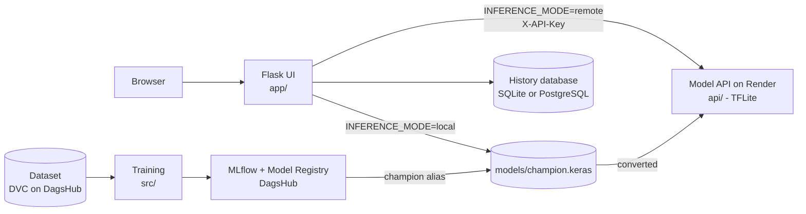

# VisionGuard (23L-0787_A2_Ops)

[](https://github.com/Abdul-Rehman-0787/23L-0787_A2_Ops/actions/workflows/ci.yml)

VisionGuard is a web service that tells whether an uploaded image is **AI-generated** or **real**. It is an end-to-end MLOps project: data versioning (DVC), model training (TensorFlow/Keras), experiment tracking and a model registry (MLflow on DagsHub), a Flask web app with a persistent prediction history, Docker Compose packaging, continuous integration (GitHub Actions) and cloud deployment (Render).

**Author:** Abdul-Rehman, roll number 23L-0787, BSCS, FAST NUCES Lahore

## Live links

| What | Link |
|---|---|
| Web app (Flask UI) | https://two3l-0787-a2-ops.onrender.com/ |
| Model API (health check) | https://visionguard-vkzn.onrender.com/health |
| Source code | https://github.com/Abdul-Rehman-0787/23L-0787_A2_Ops |
| Experiments, data and model registry | https://dagshub.com/Abdul-Rehman-0787/23L-0787_A2_Ops |

The services run on Render's free tier and **sleep after about 15 minutes without traffic**. The first request after a pause can take around a minute. Open the API `/health` page and the web app a minute before a demo.

`POST /predict` on the API needs an `X-API-Key` header. The key is stored only in Render's environment settings and in a git-ignored `.env`, never in the repository.

## Continuous integration

Every push to `main` and every pull request runs `.github/workflows/ci.yml`:

| Job | What it does |
|---|---|
| `test` | Installs `requirements.txt`, lints with `ruff check app tests run.py`, runs `pytest -q` |
| `docker` | Runs after `test` passes and builds the Docker image |

The tests use a fake predictor and a temporary SQLite file, so CI needs neither the model nor any secret. They cover the health route, rejection of wrong file types, undecodable images and oversized uploads, and a valid upload being written to the history page.

Run the same checks locally before pushing:

```powershell
pytest -q
ruff check app tests run.py
```

The badge at the top of this file shows the status of the latest run. All runs are listed under the repository's **Actions** tab.

## Architecture



The routes only call `predictor.predict(image_bytes)`. Two interchangeable predictors implement it:

- `app/inference.py`: loads the Keras champion once at start-up and runs it locally.
- `app/remote.py`: sends the image to the cloud API, with a timeout and retries for the "waking up" responses (502, 503, 504). It never retries a 401.

## Dataset

[AI Generated Images vs Real Images](https://www.kaggle.com/datasets/cashbowman/aigenerated-images-vs-real-images) from Kaggle. The label of an image is the folder it sits in (`AiArtData` is class 1, `RealArt` is class 0).

| | Count |
|---|---|
| Images audited | 975 (539 AI, 436 real) |
| Corrupt files | 0 |
| Exact duplicates (SHA-256) | 1, removed before splitting |
| Train / validation / test | 681 / 146 / 147 (stratified, seed 42) |

The raw images are **not in Git**. DVC tracks them (`data/raw.dvc`) and the files live in DagsHub storage. The small split lists in `data/splits/` are committed.

## Models

| Model | Summary |
|---|---|
| Baseline CNN | Three Conv + BatchNorm + ReLU + MaxPool blocks (32, 64, 128 filters), global average pooling, dropout, one sigmoid output |
| Transfer learning | ImageNet-pretrained MobileNetV2 without its classifier. Stage 1 trains only the new head (learning rate 1e-3). Stage 2 unfreezes the last block with a much smaller learning rate (1e-5), keeping BatchNorm frozen |

Common training choices: 224x224 input, augmentation (flip, rotation, zoom, contrast) on the training split only, binary cross-entropy with Adam, fixed seed, early stopping, checkpointing on validation loss and learning-rate reduction.

Selected results (validation loss, lower is better; full metrics are in the DagsHub experiments):

| Run | Best epoch | Validation loss |
|---|---|---|
| Baseline CNN | 29 | 0.5901 |
| MobileNetV2, stage 2 (fine-tuned) | 7 | 0.4778 |
| Best Keras Tuner trial (30 unfrozen layers, dropout 0.2, lr 6.6e-5) | n/a | 0.4250 |

The model registered as **`visionguard`** with the alias **`champion`** is the one deployed. The cloud API reports version 2 with a decision threshold of 0.48, chosen on the validation split. Test-set metrics are reported once, in the project report.

## Experiment tracking

Experiments are logged to MLflow on DagsHub through environment variables (see `.env.example`). Runs record parameters, per-epoch metrics, tags (git commit, DVC data hash, seed), and artifacts (confusion matrix, ROC curve, split lists, package list, model). The experiment `visionguard` holds the comparison runs, each differing from another by one change: learning rate, augmentation, unfrozen layers, image size, backbone, and manual versus autolog logging.

## Repository layout

```
app/              Flask UI (routes, templates, static files, DB model, predictors)
api/              Model API for Render (Flask + TFLite, API-key protected)
src/              Data audit, EDA, splits, training, tuning, MLflow, registry, TFLite conversion
tests/            pytest tests used by CI
data/             DVC pointer (raw.dvc), audit.csv, splits/
reports/          Figures and small result files
.github/workflows/ci.yml
Dockerfile        Web app image (slim base, non-root user, health check)
docker-compose.yml  Web app + PostgreSQL stack
requirements.txt  Web app (Docker/CI) dependencies
requirements-web.txt  Lean dependencies for the cloud UI (no TensorFlow)
```

## Quick start

Everything below is for Windows PowerShell from the project root.

### 1. Environment and data

```powershell
python -m venv .venv
.venv\Scripts\Activate.ps1
pip install -r requirements-full.txt
dvc pull -r origin
```

Copy `.env.example` to `.env` and fill in your own values. `.env` is git-ignored.

### 2. Run the web app locally

```powershell
python src\download_champion.py     # fetches models/champion.keras from the registry
python run.py
```

Open http://127.0.0.1:5000. To use the cloud model instead of the local file, set `INFERENCE_MODE=remote`, `API_URL` and `API_KEY` in `.env`.

### 3. Run with Docker Compose

```powershell
docker compose up -d --build
docker compose ps
curl.exe -i http://localhost:5000/health
```

- The `db` service (PostgreSQL) uses a named volume, a health check and publishes **no port**. The web app reaches it by the service name `db`.
- The `web` service waits for the database to be healthy. The model is mounted read-only from `./models`, so it is not baked into the image.
- All passwords come from the untracked `.env`.

Stop with `docker compose down` (add `-v` only if you also want to delete the history volume).

### 4. Reproduce the training

```powershell
python src\audit.py
python src\make_splits.py
python src\train_mlflow.py --run-name r1_base
python src\compare_runs.py
python src\register_model.py <RUN_ID> champion
```

## Configuration

| Variable | Purpose | Default |
|---|---|---|
| `INFERENCE_MODE` | `local` (Keras file) or `remote` (cloud API) | `local` |
| `API_URL`, `API_KEY`, `API_TIMEOUT` | Cloud API address, key and timeout (seconds) | empty, empty, 90 |
| `MODEL_PATH`, `MODEL_NAME`, `MODEL_VERSION`, `THRESHOLD` | Local model file and the values recorded in history | `models/champion.keras`, `visionguard`, `unknown`, `0.5` |
| `DATABASE_URL` | SQLAlchemy URL for the history database | `sqlite:///instance/visionguard.db` |
| `MAX_UPLOAD_MB` | Upload size limit | 5 |
| `POSTGRES_USER`, `POSTGRES_PASSWORD`, `POSTGRES_DB` | Compose database credentials | set in `.env` |
| `MLFLOW_TRACKING_URI`, `MLFLOW_TRACKING_USERNAME`, `MLFLOW_TRACKING_PASSWORD` | DagsHub MLflow access | set in `.env` |

## Web app

| Route | Description |
|---|---|
| `/` | Upload page with drag and drop, result card and confidence ring |
| `/predict` (POST) | Validates the file, runs the model, stores the result |
| `/history` | Every prediction: what was decided, when, by which model and version, and how confidently |
| `/health` | JSON health check (database and model status) |

Uploads are validated by type, size and by actually decoding the image. File names are sanitized and the image itself is never written to disk. Errors are shown as friendly messages.

## Model API

`GET /health`

```json
{"model": "visionguard", "status": "ok", "threshold": 0.48, "version": "2"}
```

`POST /predict` with header `X-API-Key: <key>` and multipart form field `file`:

```powershell
curl.exe -H "X-API-Key: $env:API_KEY" -F "file=@photo.jpg" https://visionguard-vkzn.onrender.com/predict
```

```json
{
  "label": "AI-generated",
  "confidence": 0.94,
  "prob_ai": 0.94,
  "threshold": 0.48,
  "model_name": "visionguard",
  "model_version": "2",
  "width": 1024,
  "height": 1024,
  "file_size": 123456,
  "latency_ms": 85.2
}
```

| Status | Meaning |
|---|---|
| 200 | Prediction returned |
| 400 | No file in field `file`, or the file cannot be decoded |
| 401 | Missing or wrong API key |
| 413 | File larger than 5 MB |
| 415 | Unsupported image type (allowed: JPEG, PNG, WEBP) |

The API runs a TFLite copy of the champion with a small runtime, because Render's free tier has 512 MB of RAM. Preprocessing is a bilinear resize to the model's input size; the rescaling layer is inside the model. The difference between this and the TensorFlow resize used in training was measured and is reported in the project report.

## Deployment

| Component | Platform | Notes |
|---|---|---|
| Model API (`api/`) | Render web service, free instance | Python runtime, root directory `api`, API key in environment settings |
| Web app (UI) | Render web service, free instance | Uses `requirements-web.txt` and `INFERENCE_MODE=remote` |
| Data and experiments | DagsHub | DVC storage and MLflow tracking server |

The assignment's required setup is the model API in the cloud and the Flask app calling it. The Flask app also runs on localhost and in Docker Compose.

## Limitations

- The dataset is small (975 images), so scores have wide uncertainty and the model can be wrong on edited images, screenshots or styles it has not seen.
- Confidence is a model score, not a guaranteed probability. VisionGuard gives an estimate, not proof of origin.
- Free-tier services sleep when idle and have limited CPU.

## Acknowledgements

Dataset by cashbowman on Kaggle. An AI assistant (Claude, by Anthropic) was used for guidance while building this project; see the disclosure in the project report.
